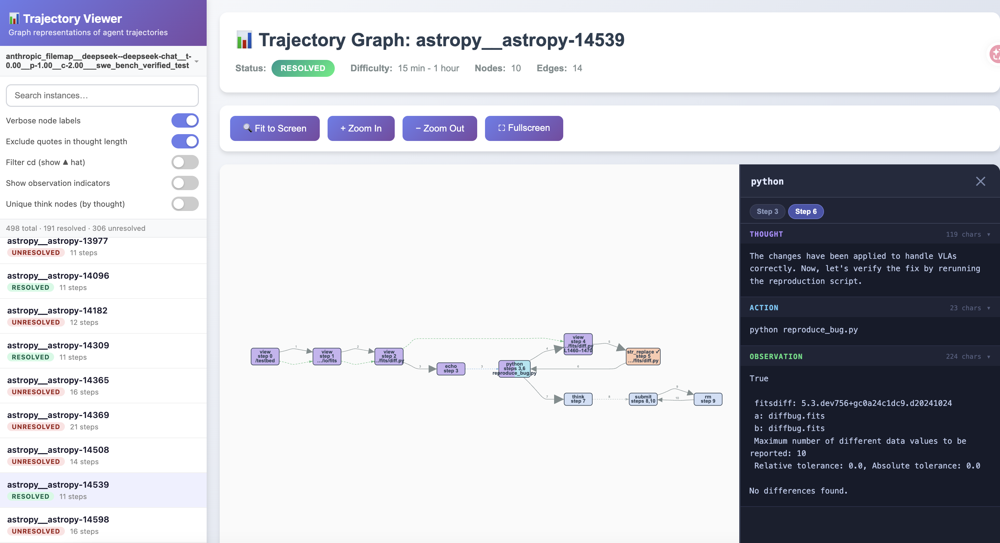

# Graph Construction

The **live server** interactively visualises SWE-agent, OpenHands, mini-swe-agent, Claude Code, and Codex trajectories on demand in the browser. The existing **batch export script** pre-generates graph JSON files for the benchmark-oriented formats documented below.

---

## Live Server

`live_graph_server.py` starts a local HTTP server and renders every trajectory as an interactive graph on demand. Nothing is written to disk. The agent type is detected automatically from the path you pass.

### Quick Start

**SWE-agent** — pass the directory that contains your `.traj` files:

```bash
python live_graph_server.py \
    --trajs path/to/trajectories \
    --eval_report path/to/report.json
```

**OpenHands** — pass the `output.jsonl` file directly:

```bash
python live_graph_server.py \
    --trajs path/to/output.jsonl \
    --eval_report path/to/report.json
```

**Claude Code** - pass a compatible session root whose `state.json` records `custom.sourceFramework: "Claude Code"`. This preserves the Claude Code framework label even when a different model generated the trajectory. Shell executables are normalized by basename, so commands such as `/opt/venv/bin/pytest`, `/opt/venv/bin/mypy`, `black --check`, and `isort --check` are classified as localization before a source edit and validation after one:

```bash
python graph_construction/live_graph_server.py \
    --trajs path/to/claude-code-sessions
```

**Codex** - pass the Codex session root or one persisted `rollout-*.jsonl` file. An evaluation report is optional:

```bash
python graph_construction/live_graph_server.py \
    --trajs ~/.codex/sessions
```

In Windows PowerShell, use `$HOME\.codex\sessions`; in Command Prompt, use `%USERPROFILE%\.codex\sessions`. Graphectory recursively discovers rollout files, pairs tool calls with outputs by call ID, expands shell and `apply_patch` activity, and retains final responses. Codex does not persist private chain-of-thought in these logs, so the viewer's thought field contains only visible assistant commentary and any explicitly surfaced reasoning summaries.

Then open **http://localhost:8000** in your browser.

The live server starts without downloading SWE-bench metadata. If you need
dataset difficulty labels in locally constructed graphs, set
`GRAPHECTORY_LOAD_SWEBENCH_DIFFICULTIES=1` before starting it.

When Docker is used, expose the port when starting the container, for example:

```bash
docker run -it -p 8000:8000 graphectory bash
```

Then run the server inside the container.


*Live server interface showing instance list (left) and interactive graph visualization (right) with phase-colored nodes.*

### Arguments

| Argument | Required | Default | Description |
|---|---|---|---|
| `--trajs` | ✓ | — | Supported trajectory directory or JSONL file. Compatible Claude Code sessions use a session root; Codex accepts `~/.codex/sessions` or one rollout JSONL file. |
| `--eval_report` | | — | Optional SWE-bench evaluation report JSON containing `"resolved_ids"` and `"unresolved_ids"` arrays. |
| `--assets_dir` | | script directory | Directory containing `graph_template.html`, `styles.css`, and `graph_renderer.js`. Only needed if you have moved those files elsewhere. |
| `--port` | | `8000` | Port to serve on. |

### The Browser UI

The left sidebar lists every trajectory found in the provided path. Large sources are scanned in background batches of ten, so the tutorial remains visible in the main canvas while the sidebar reports progress such as `20 out of 217 loaded`. Each entry shows the instance ID, a coloured status badge (resolved / unresolved / unsubmitted), and a step count. The search box filters the list in real time by instance ID substring. The collapsible **Data source** section accepts manually entered paths and, when the server runs on a local desktop, native file and folder pickers.

Clicking an entry loads its graph into the main canvas. The graph is rendered inside a sandboxed iframe; switching instances swaps the content without reloading the page. Its floating question-mark control opens the phase and edge legend.

The optional **File footprint** panel organizes referenced paths into a nested tree and links each entry back to the graph nodes that touched it. Codex and Claude Code planning actions also appear as a synthetic **Plan** entry, with plan updates shown as edits so planning activity can be inspected alongside source-file activity.

For trajectories with more than 100 graph nodes, a compact view selector beside the title offers the full graph and selectable 50--150-node segments. Runs under 200 nodes open to the full graph by default; larger runs open to subgraph 1 to keep the initial canvas responsive. Segment boundaries prefer nodes in the **Plan** phase so that planning transitions remain visible; when a long trajectory has no plan nodes, the viewer chooses low-degree boundary nodes to avoid introducing additional visual hubs. Segments overlap at their boundary node, and crossing edges use muted previous/next-segment context anchors so nodes do not lose visible connections when their neighbor is outside the selected window. The underlying trajectory and all raw step tuples remain available through node inspection. The first and last nodes of the displayed view are marked directly on the canvas.

#### View Toggles

Four toggles sit inside the expandable gear menu at the top right of the graph canvas. Changing any of them immediately re-requests the current graph with the new settings applied.

| Toggle | Default | Effect |
|---|---|---|
| **Exclude quotes in thought length** | On | Strips content inside backticks and quote characters before measuring thought length, so arrowhead sizes reflect genuine reasoning rather than copied code. |
| **Filter repeated commands (show cat ears)** | Off | When one action has 10 or more outgoing blue edges, collapses repeated edges while retaining one connection to every distinct target neighbor, then marks affected targets with colored cat ears. Ear colors identify the collapsed source action. |
| **Show observation indicators** | Off | Draws a small coloured square on each edge at the 25% point, encoding the length and success/failure outcome of the previous step's tool response. |
| **Unique think nodes (by thought)** | Off | When on, each `think` step with distinct thought text becomes its own node rather than all think steps collapsing into one. Two steps with identical thought text still share a node. |

#### Reading the Graph

Nodes are coloured by **phase**:

| Colour | Phase | Meaning |
|---|---|---|
| Purple | Localization | Reading files, searching code, running tests before any patch |
| Orange | Patch | Creating or editing source files |
| Blue | Validation | Running tests, static analysis, or formatter checks after a patch exists |
| Gold | Plan | Explicit planning and todo actions in Codex and Claude Code |
| Light blue | General | Everything else (think steps, submission, navigation, etc.) |

A node can show two colours as a horizontal gradient when the same action was visited in multiple phases across repeated steps.

Edges are styled by **type**:

| Style | Meaning |
|---|---|
| Grey solid, scaled arrowhead | Normal execution. Arrowhead size encodes thought length; larger arrowheads indicate longer reasoning text on that transition. |
| Red solid | Thought continuation — the model's thought for this step was identical to or a prefix of the previous step's, indicating cached reasoning. |
| Blue dashed | Intra-step — connects sub-actions within a single `&&`-chained step. |
| Green dashed | Hierarchy — drawn between `str_replace_editor view` nodes when one path is a subdirectory or line-range subset of another. |

When consecutive execution edges connect the same two nodes, the viewer combines them into one arrow and labels it with the covered step range, such as `12-16`. Non-consecutive repetitions remain separate so loops and revisits stay visible.

Click any node to open a detail sidebar showing the full thought, action, and observation text for that node. If the node was visited multiple times, tab buttons let you page through each visit. The sidebar's left edge is draggable to resize it.

### Analyze API (send a trajectory over HTTP)

When the server runs in Docker, the container cannot see files on the client's machine. `POST /api/analyze` takes the trajectory itself in the request body and returns its graph, without changing the dataset the browser UI is showing:

```bash
# SWE-agent .traj / mini-swe-agent .traj.json → interactive graph page
curl -X POST -H 'Content-Type: application/json' \
     --data-binary @django__django-10973.traj \
     'http://localhost:8000/api/analyze?id=django__django-10973' -o graph.html

# Claude Code transcript / Codex rollout / OpenHands output.jsonl → graph as JSON
curl -X POST -H 'Content-Type: application/x-ndjson' \
     --data-binary @session.jsonl \
     'http://localhost:8000/api/analyze?format=json'
```

| Query parameter | Meaning |
|---|---|
| `agent` | `sa`, `msa`, `oh`, `claude`, `codex`, `opendraco2` or `opendraco`; auto-detected when omitted. |
| `id` | Instance name (letters, digits, `.`, `_`, `-`); also picks one entry from a multi-instance OpenHands JSONL. |
| `format` | `html` (default, the same page as the UI) or `json` (networkx node-link data). |
| `filter_cd`, `thought_quotes`, `show_observation`, `filter_repeated`, `unique_think` | Same view toggles as `/api/graph`. |

The body is staged in a private temporary directory, parsed only as JSON/JSONL, and deleted before the response is sent. Requests must use `Content-Type: application/json`, `application/x-ndjson` or `application/jsonl`, and a browser `Origin` must match the server's host, so other websites cannot submit on a visitor's behalf. Limits are set with `GRAPHECTORY_UPLOAD_MAX_MB` (default 20) and `GRAPHECTORY_UPLOAD_SLOTS` (concurrent uploads, default 2; extra requests get `503`). Errors: `400` bad input, `411`/`413` missing or oversized body, `415` wrong content type, `422` data the builders cannot graph.

#### OpenDraco2 multi-agent runs (`agent=opendraco2`)

An [OpenDraco2](https://github.com/xiangfengyepan/OpenDraco2) run is several agents handing work to each other, recorded in one `runs/<run_id>/run.jsonl`. Send that file as `application/x-ndjson`. It is auto-detected when its first record is `run_started` with `framework_version` and `topology`.

```bash
curl -X POST -H 'Content-Type: application/x-ndjson' --data-binary @run.jsonl \
     'http://localhost:8000/api/analyze?agent=opendraco2' -o run.html
```

You get two things:

1. **One graph per agent.** Each agent's turns (`local_turn` order) become an ordinary Graphectory trajectory, built by the existing Claude Code builder, so nodes, phases, outcomes and every metric behave as for the other formats:
   - `thinking`, and any `message` that comes before a tool call, are the step's thought.
   - `tool_call` + `tool_result` is an action and its observation. Results are paired within one activation only, because models reuse ids like `call_0` every turn.
   - The last message of a turn that calls no tool is a `final_answer` action.
   - The deliveries that started a turn begin its first thought as `from <agent>: <value>`, or `from the parent run` for a fork.
   - Phases: `bash` goes through commandParser and the shell rules, using the exit code from the result text. `read` is localization. `write` is patch, or localization/validation for test paths. `web_search` is localization. Any other tool gets the generic rule.
   - **Run-aware validation** (`phases=run`, the default): an edit by *any* agent counts as a prior patch for actions in later supersteps. That edit is a `workspace_commit` in an earlier superstep, and supersteps are barriers. Without this, a tester agent running the tests for another agent's fix would read as localization. `phases=agent` keeps the strict per-trajectory classification.
2. **The run view.** It shows how the agents worked together:
   - **Agent graph:** each node shows the agent's activations, phase mix, tokens, duration and whether it changed the workspace. Edges are deliveries (count, supersteps, edge id), and conditional routing appears as labelled `route` edges (choice, picked / decisions).
   - **Timeline:** supersteps × agents, one block per activation and an arrow per delivery. Abandoned activations are hatched, with their rerun beside them.
   - **Pattern detection,** with no model involved. Thresholds are in `opendraco2_runs/patterns.py` (`PATTERN_CONFIG`):

| Pattern | Fires when | Default |
|---|---|---|
| `ping_pong` | Two agents hand work back and forth N+ times in a row with no `workspace_commit` in between | N = 4 |
| `stalled_handoff` | An agent is activated M+ times, never calls a tool or changes a file, and only passes its input on | M = 3 |
| `router_churn` | One `route_decision` group picks the same target K+ times | K = 3 |
| `hot_agent` | One agent takes more than X of all activations or all tokens (two or more agents) | X = 70 % |

Extra parameters: `agent_id=<agent>` returns only that agent's graph (HTML page, or the single-agent JSON shape); `phases=run|agent`. `id`, `format`, the view toggles, limits and errors are as above.

`format=html` is one standalone page. dagre is inlined, nothing is fetched, and it works saved to disk or inside a sandboxed iframe. The run view is on top, with one tab per agent below; each tab holds that agent's ordinary graph page in a `sandbox="allow-scripts"` iframe. All run text is treated as untrusted. It is embedded as escaped JSON and placed in the DOM with `textContent` only.

`format=json`:

```jsonc
{
  "run_id": "2026-10-23-a002", "id": "2026-10-23-a002",   // id = ?id= or run_id
  "agent_type": "opendraco2",
  "status": "completed",            // run_finished.status, or "in_progress" with no run_finished
  "phase_scope": "run",             // or "agent" with ?phases=agent
  "agents": {                       // per agent: the same shape as a single-agent format
    "writer": {"instance_id": "writer", "agent_type": "opendraco2", "nodes": 1, "edges": 0, "graph": { /* node-link */ }}
  },
  "run_graph": {                    // networkx node-link (MultiDiGraph)
    "directed": true, "multigraph": true,
    "graph": {
      "run_id": "…", "status": "…", "framework_version": "…",
      "forked_from": null,          // {run_id, superstep, activation_uuid} on a fork
      "resumed_at": [],             // supersteps of run_resumed records
      "truncated": false,           // last line was half-written
      "skipped_lines": 0, "supersteps": 2, "errors": [{"agent_id": "…", "message": "…"}],
      "timeline": {
        "activations": [{"uuid", "agent_id", "superstep", "local_turn", "status" /* finished|abandoned|running */,
                         "rerun_of", "tokens", "duration_s", "stop_reason", "tool_calls", "changed_paths",
                         "from_parent_run", "started_at"}],
        "deliveries":  [{"uuid", "from_agent", "to_agent", "edge_id", "from_activation", "to_activations",
                         "superstep" /* producer's; null for START */, "preview" /* first 280 chars */}]
      }
    },
    "nodes": [{"id": "writer", "kind": "agent" /* agent|start|end|external */, "mode": "unconditional",
               "activations": 1, "abandoned_activations": 0, "running_activations": 0, "tool_calls": 0,
               "phase_mix": {"general": 1}, "tokens": {"input_tokens", "output_tokens", "total_tokens"},
               "duration_s": 0.0, "changed_workspace": false, "commits": 0, "changed_paths": [], "model": "…"}],
    "edges": [
      {"source": "writer", "target": "reviewer", "key": "delivery:e2", "type": "delivery", "edge_id": "e2",
       "slot": "task", "count": 1, "supersteps": [1], "from_parent_run": 0},
      {"source": "writer", "target": "reviewer", "key": "route:writer:reviewer", "type": "route",
       "group": "writer", "choice": "reviewer", "count": 3, "of": 4, "outcomes": ["reviewer", "end"], "supersteps": [1, 3, 5]}
    ]
  },
  "patterns": [{"kind": "ping_pong", "agents": ["reviewer", "writer"], "supersteps": [1, 2, 3, 4, 5, 6],
                "summary": "…one sentence…", "evidence": {}}],
  "pattern_config": {"ping_pong_min_exchanges": 4, "stalled_min_activations": 3,
                     "router_churn_min_repeats": 3, "hot_agent_share": 0.7}
}
```

Topology edges the run never used are kept with `count: 0`. Deliveries use the append policy, so `caused_by` lists everything an agent has ever received. Arrows and context lines use only what each turn saw first.

#### OpenDraco inference event logs (`agent=opendraco`)

The public [OpenDraco](https://github.com/OpenDraco/OpenDraco) (LangGraph, SWE-bench) records each inference run as `opendraco/logs/inference_logs/<stem>.ndjson`: the event stream its web UI shows. It is auto-detected when its first record is `run_meta` with `config_name` and `instance_ids`. One file holds one or more SWE-bench instances; `id=<instance_id>` picks one (default: the first).

```bash
curl -X POST -H 'Content-Type: application/x-ndjson' --data-binary @20261024-0900-swebench.ndjson \
     'http://localhost:8000/api/analyze?agent=opendraco&id=django__django-10973' -o run.html
```

The chosen instance is rewritten as OpenDraco2 records (`opendraco_runs/events.py`), so the per-agent graphs, run view, patterns and page above all apply:

| Event | Becomes |
|---|---|
| `thinking_chunk`, `response` | the step's thought; one `response` (one model call) = one step |
| `tool_call` | an action with its result. Tools are sorted by name (`opendraco_runs/tools.py`) into read / write / search / test / shell kinds for phases; shell tools become parsed bash commands |
| `agent_input`, `handoff` | deliveries (from START, or from the agent that handed off) |
| `agent_event` | the end of that agent's turn |
| `agent_tokens` | the agent's token totals, on its last turn |
| `instance_done` | `status: completed`, and `final_patch_paths` from the patch |

The log is lossier than OpenDraco2's, and the response says what was derived (`run_graph.graph.derived`):
- Tool arguments are previews, with each value cut to 40 characters, so a bash command longer than that is parsed from its first 40 characters.
- Results are at most 80 characters (`ok=True`, `N items`, `Error: …`), so failures come from `ok=False` / `Error` only.
- Supersteps come from hand-off order.
- A turn that called a write-kind tool gets an inferred workspace commit for run-aware phases and ping-pong detection.
- Durations and per-turn tokens are not recorded.
- There are no `route_decision` records: the router's choice shows up only as its hand-offs.

`format=json` adds `instance_id`, `instances` (every instance in the file) and `config_name` to the OpenDraco2 shape; `agent_type` is `opendraco`.

---

## Batch JSON Export (`generatejson.py`)

`generatejson.py` processes a batch of trajectories and writes one graph JSON file per instance. This is useful for archiving graphs, diffing runs offline, or loading graphs into other tools.

### Quick Start

**SWE-agent with DeepSeek-V3:**
```bash
python graph_construction/generatejson.py \
  --agent sa --model dsk-v3 \
  --trajs data/samples/SWE-agent/trajectories/anthropic_filemap__deepseek--deepseek-chat__t-0.00__p-1.00__c-2.00___swe_bench_verified_test \
  --eval_report data/SWE-agent/reports/deepseek-chat.json \
  --output_dir data/samples
```

**OpenHands with Claude-Sonnet-4:**
```bash
python graph_construction/generatejson.py \
  --agent oh --model cld-4 \
  --trajs data/samples/OpenHands/trajectories/deepseek-chat_maxiter_100_N_v0.40.0-no-hint-run_1/sample_output.jsonl \
  --eval_report data/samples/OpenHands/trajectories/deepseek-chat_maxiter_100_N_v0.40.0-no-hint-run_1/report.json \
  --output_dir data/samples
```

**mini-swe-agent with gpt-5-mini:**
```bash
python graph_construction/generatejson.py \
  --agent msa --model gpt-5-mini \
  --trajs data/samples/mini-swe-agent-v2.1/trajectories/gpt-5-mini \
  --eval_report data/samples/mini-swe-agent-v2.1/reports/gpt-5-mini.json \
  --output_dir data/samples
```

**Output**: `{output_dir}/{Agent}/graphs/{model}/{instance_id}/{instance_id}.json`

### Arguments

| Argument | Required | Default | Description |
|---|---|---|---|
| `--agent` | ✓ | — | Agent type: `sa` (SWE-agent) or `oh` (OpenHands). |
| `--model` | ✓ | — | Model shorthand — controls the output subdirectory name. See table below. |
| `--trajs` | ✓ | — | Directory of `.traj` files (SA) or path to `output.jsonl` (OH). |
| `--eval_report` | ✓ | — | SWE-bench evaluation report JSON. |
| `--output_dir` | ✓ | — | Root output directory. Graphs are written under `{output_dir}/{Agent}/graphs/{model}/`. |
| `--workers` | | `8` | Number of parallel worker processes. |

#### Model Shorthands

| Flag | Full name written to disk |
|---|---|
| `dsk-v3` | `deepseek-v3` |
| `dsk-r1` | `deepseek-r1-0528` |
| `dev` | `devstral-small` |
| `cld-4` | `claude-sonnet-4` |

### Output Structure

```
output/
├── SWE-agent/
│   └── graphs/
│       └── deepseek-v3/
│           └── django__django-12345/
│               └── django__django-12345.json
└── OpenHands/
    └── graphs/
        └── claude-sonnet-4/
            └── django__django-12345/
                └── django__django-12345.json
```

Each JSON file is a NetworkX node-link graph. Nodes carry label, phase, step indices, thought lengths, tool/command metadata, and the full thought/action/observation text for every visit. Edges carry type (`exec`, `hier`), step index, and thought length.

---

## How Graphs Are Built

Both `generatejson.py` and `live_graph_server.py` share the same graph construction pipeline:

1. **Parsing**: Agent trajectories → atomic actions using [commandParser.py](commandParser.py)
2. **Node Deduplication**: Identical actions merged with occurrence tracking
3. **Phase Classification**: Actions categorized using heuristics ([mapPhase.py](mapPhase.py)):
   - **Localization**: Information gathering, searching, test generation before patching
   - **Patch**: Creating/editing non-test files
   - **Validation**: Running tests, static analysis, formatter checks, or editing test files after patching
   - **Plan**: Explicit planning and todo actions in Codex and Claude Code
   - **General**: Other actions (environment setup, navigation, and submission)
4. **Edge Construction**: Temporal edges (sequential execution flow) + structural edges (hierarchical relationship in the code base) + Thought continuation (If the current step's thought is identical to or a prefix of the previous step's thought, the connecting edge is flagged as a thought continuation and drawn in red, making it easy to spot steps where the model reused cached reasoning.)
5. **Output**:
   - `generatejson.py`: JSON files (NetworkX node-link format)
   - `live_graph_server.py`: Interactive HTML visualization with phase-colored nodes

**Graph Metadata**: Each graph includes `resolution_status`, `instance_name`, and `debug_difficulty`

For detailed graph construction details, see [buildGraph.py](buildGraph.py).

---

## Extending Graphectory

### Adding New Models

The four models (`dsk-v3`, `dsk-r1`, `dev`, `cld-4`) are pre-configured for paper reproducibility. To add new models, edit [generatejson.py:38](generatejson.py#L38):

```python
SUPPORTED_MODELS = {"dsk-v3", "dsk-r1", "dev", "cld-4", "my-model"}
```

Then run with your new model:
```bash
python graph_construction/generatejson.py \
  --agent sa --model my-model \
  --trajs <your_trajectories> \
  --eval_report <your_report> \
  --output_dir <output>
```

### Supporting New SWE-agent Tools

To parse custom SWE-agent tools, add their `config.yaml` files to [generatejson.py:222-234](generatejson.py#L222-L234):

```python
def setup_parser_for_agent(agent: str) -> CommandParser:
    parser = CommandParser()
    tool_configs = []
    if agent == "sa":
        tool_configs = [
            "data/SWE-agent/tools/edit_anthropic/config.yaml",
            "data/SWE-agent/tools/review_on_submit_m/config.yaml",
            "data/SWE-agent/tools/registry/config.yaml",
            "data/SWE-agent/tools/your_custom_tool/config.yaml",  # Add here
        ]
    if tool_configs:
        parser.load_tool_yaml_files(tool_configs)
    return parser
```

### Supporting New Agents

To add support for a new agent framework:

1. **Implement trajectory builder** in [buildGraph.py](buildGraph.py) (see existing functions at lines 274 & 365):
   ```python
    def build_graph_from_newagent_trajectory(traj_data, parser, instance_id, output_dir, eval_report_path):
        builder = GraphBuilder()
        # Parse agent-specific trajectory structure
        # Convert to builder.add_or_update_node() calls
        return builder.finalize_and_save(output_dir, instance_id, eval_report_path)
   ```

2. **Register the agent** in [generatejson.py:37-50](generatejson.py#L37-L50):
   - Update `SUPPORTED_AGENTS` and `AGENT_NAMES`

3. **Add trajectory loading logic** in [generatejson.py](generatejson.py):
   - Update `load_trajectories()` to handle NewAgent's file format
   - Add branch in `GraphProcessor.process_trajectory()` to call your builder function

**Key principle**: Different agents have different trajectory formats, but all generate the same unified graph structure (nodes with phases, execution/hierarchical edges, metadata).

---
